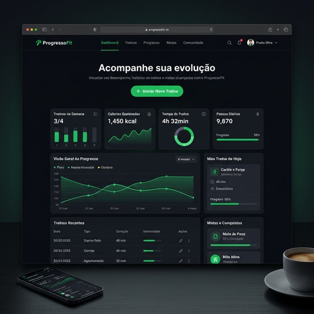
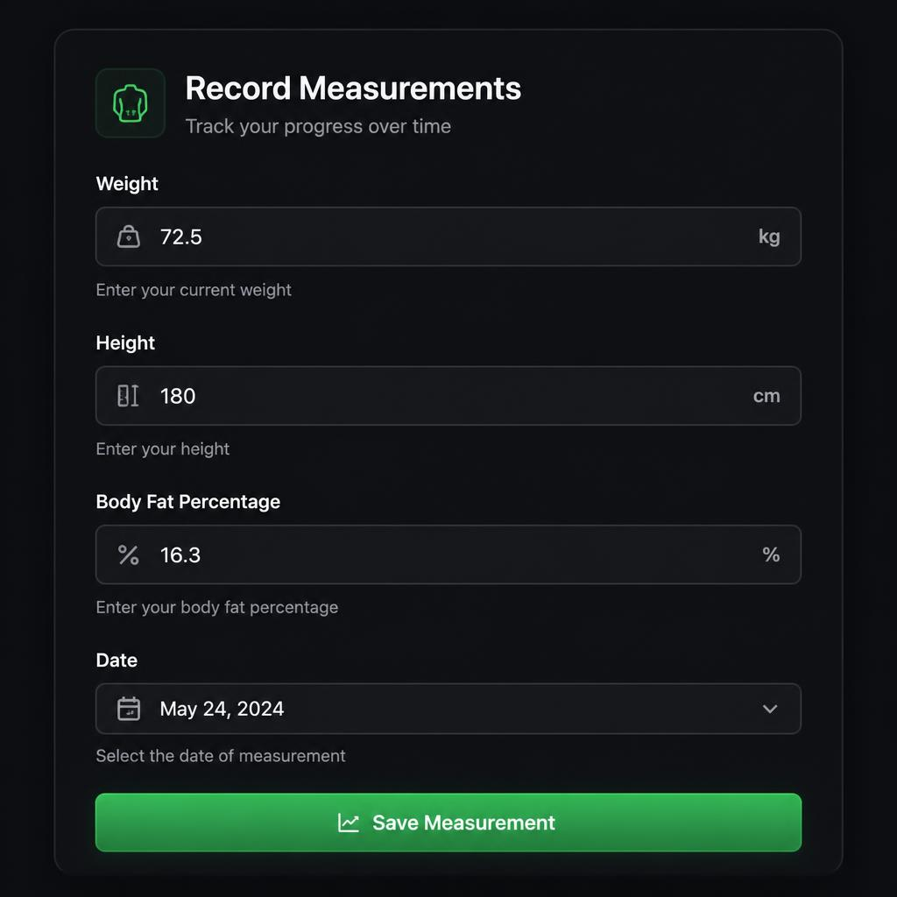
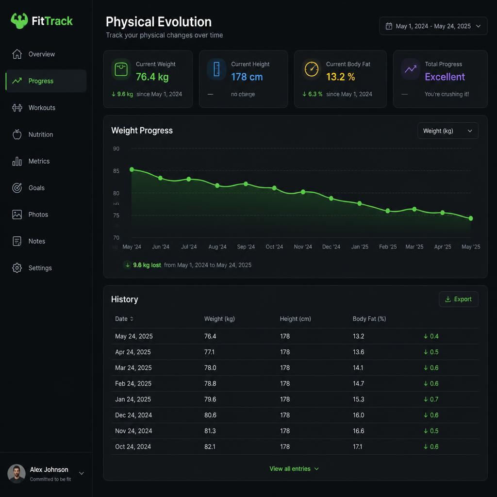
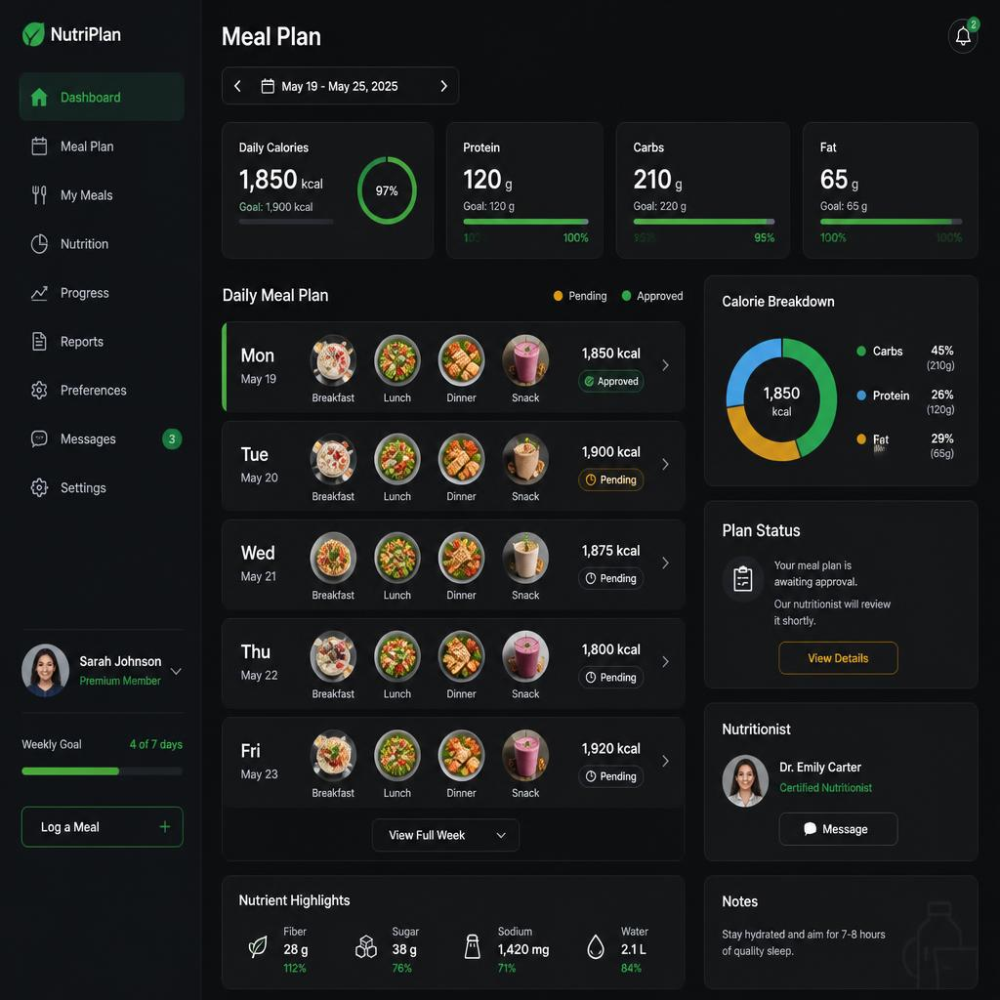

# Documentação do Tema e Protótipos — ProgressoFit

## 1. Ideia do Sistema
O **ProgressoFit** é um sistema web desenvolvido para auxiliar praticantes de atividades físicas no acompanhamento inteligente e contínuo da sua evolução corporal e rotina de treinos. A plataforma permite centralizar o registo de medições físicas, visualização de dados de progresso e acesso a planos de treino e nutrição devidamente geridos por profissionais da área.

O objetivo principal é substituir o acompanhamento informal e descentralizado por uma interface moderna, acessível e intuitiva, promovendo a consistência dos utilizadores através da visualização clara dos seus resultados ao longo do tempo.

---

## 2. Perfis de Utilizador
* **Aluno (Praticante):** Regista medições corporais (peso, altura, % de gordura, circunferências), visualiza gráficos e tabelas de evolução, e acede aos seus planos de treino e nutrição.
* **Especialista (Nutricionista / Educador Físico):** Submete os seus dados de registo profissional para validação e acompanha os planos atribuídos aos seus respetivos alunos.
* **Administrador:** Gere utilizadores, concede permissões e aprova o estado de verificação dos especialistas através do painel de administração (`/admin`) do Django.

---

## 3. Arquitetura de Layout e Design
* **Estrutura Base:** Barra de navegação (`navbar`) fixa no topo, área central delimitada (`container`) para exibição do conteúdo principal e rodapé (`footer`) informativo.
* **Tema Visual:** Interface em Modo Escuro (`Dark Theme`) para maior conforto visual, utilizando fundos escuros (`#0f1115` e `#1a1d24`), texto claro (`#e8e8e8`) e cor verde de destaque (`#22c55e`) para botões de ação e identidade visual.

---

## 4. Mapeamento das Telas Principais
1. **Página Inicial (`home.html`):** Apresentação do sistema, vantagens e acesso rápido para registo/login.
2. **Entrar / Registar (`login.html` / `cadastro.html`):** Formulários de autenticação de conta e criação de novo perfil.
3. **Perfil e Edição (`perfil.html` / `perfil_editar.html`):** Visualização e alteração de dados pessoais e nível de experiência física.
4. **Registar Métrica (`registrar.html`):** Formulário para inserção de dados antropométricos (peso, altura, circunferências).
5. **Evolução Corporal (`lista.html` / `detalhe.html`):** Histórico estruturado de medições com detalhes das métricas registadas.
6. **Planos de Treino e Nutrição (`treinos.html` / `nutricao.html`):** Listagem e consulta das fichas de treino e orientação alimentar.
7. **Painel do Especialista (`validacoes.html` / `verificacao.html`):** Área de envio de credenciais e gestão de planos pendentes.

---

## 5. Protótipos Visuais das Interfaces

### Página Inicial (Home)

### Registo de Métricas Corporais

### Evolução Corporal e Histórico

### Plano Alimentar e Nutrição
